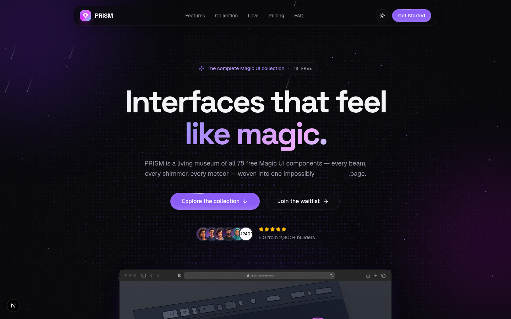
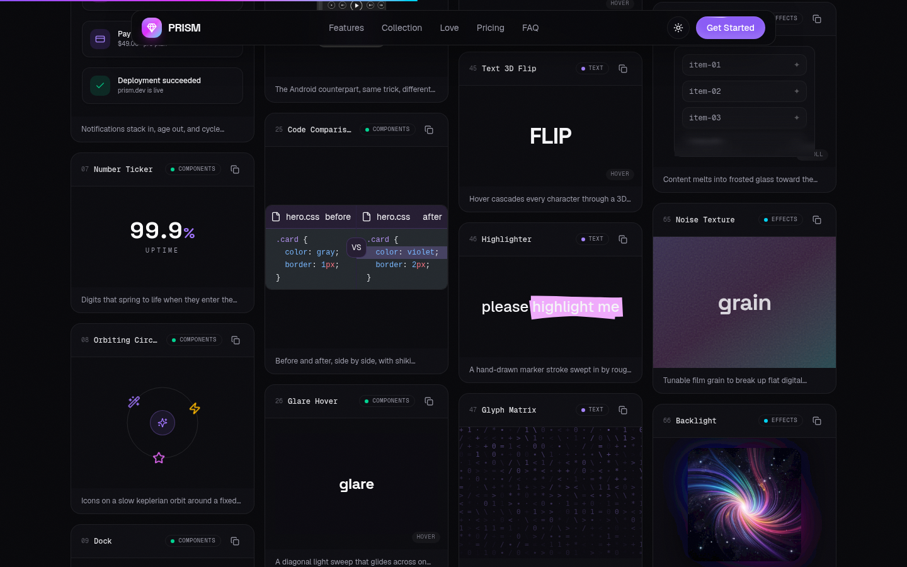

<div align="center">


# PRISM

**The complete free Magic UI collection — every component alive on one page.**

[](https://nextjs.org)
[](https://react.dev)
[](https://tailwindcss.com)
[](https://motion.dev)
[](https://magicui.design)
[](https://www.typescriptlang.org)
[](LICENSE)

[Live Preview](#-live-experience) · [Component Catalog](#-component-catalog) · [Getting Started](#-getting-started) · [Tech Stack](#%EF%B8%8F-tech-stack)

</div>

---



**PRISM** is a living showcase of the **entire free [Magic UI](https://magicui.design) catalog** — all **78 animated components** (text effects, buttons, effects and full components) running live on a single page, wrapped in a complete landing-page experience with a hero, marquee, stats, bento grid, testimonials, pricing, FAQ and a working waitlist backed by a database.

Every demo in the gallery is **real and interactive**: hover it, click it, type into it. Each card even ships with a one-click copy of its `shadcn` install command, so anything you like can be dropped straight into your own project.



> The masonry gallery — search 78 components, filter by category, and copy any install command.

## ✨ Live Experience

- **78 live component demos** — nothing is a static image; every specimen mounts only when scrolled into view to keep the page feather-light
- **The Light Chamber** — a cinematic, hand-choreographed GSAP timeline scrubbed by scroll: one beam travels, meets a prism, and disperses into seven words — then you get to drag the light yourself
- **The Refraction Room** — a five-figure scroll study closing the gallery: a live-drawn optics plate, kinetic variable-font typography, a horizontal specimen wall (magnetism, gravity, inertia, velocity, orbit) and a fully scroll-scrubbed particle burst you can play backwards
- **Searchable & filterable gallery** — full-text search plus category filters (Components · Text · Effects · Buttons) with a spring-animated pill
- **Masonry layout** — cards stack tightly by column, no wasted space, fully responsive from mobile to ultrawide
- **Dark & light themes** — animated theme toggle with a View Transition crossfade
- **Working waitlist** — email capture persisted to SQLite through Prisma, with full validation and graceful duplicate handling
- **Scroll-aware UI** — scroll progress bar, reveal-on-scroll blur fades, animated number counters
- **Zero hydration errors, zero console noise** — hydration-safe theming, scoped cursor takeovers, portal-rendered overlays

## 🧩 Component Catalog

| Category   | Count | Highlights                                                                                             |
| ---------- | ----- | ------------------------------------------------------------------------------------------------------ |
| Components | 29    | Bento Grid, Animated List, Tweet Card, Globe, Code Comparison, Docker, iPhone 15 Pro, Meteors, Orbits…  |
| Text       | 20    | Aurora Text, Blur Text, Comic Text, Gradient Text, Number Ticker, Text Reveal, Word Rotate, Shine…      |
| Effects    | 20    | Animated Grid Pattern, Border Beam, Dot Pattern, Flickering Grid, Interactive Grid, Retro Grid…         |
| Buttons    | 9     | Magnetic Button, Shimmering Button, Neon Gradient, Shine, Rainbow, Particle…                            |

All components are MIT-licensed originals from [Magic UI](https://magicui.design) — install any of them into a shadcn/ui project with:

```bash
bunx shadcn@latest add "https://magicui.design/r/<component>.json"
```

## 🚀 Getting Started

**Prerequisites:** [Bun](https://bun.sh) v1.1+ (or Node.js 20+ with npm/pnpm)

```bash
# 1. Clone
git clone https://github.com/RidwanAsli/prism.git
cd prism

# 2. Install dependencies
bun install

# 3. Set up the database (SQLite, created locally)
cp .env.example .env
bun run db:push

# 4. Start the dev server
bun run dev
```

Open [http://localhost:3000](http://localhost:3000) and enjoy the light show.

<details>
<summary>Other package managers</summary>

```bash
npm install && npm run db:push && npm run dev
# or
pnpm install && pnpm run db:push && pnpm run dev
```

</details>

### Useful Scripts

| Script              | Description                                  |
| ------------------- | -------------------------------------------- |
| `bun run dev`       | Start the dev server on port 3000            |
| `bun run build`     | Create a production build                    |
| `bun run start`     | Serve the production build                   |
| `bun run lint`      | Run ESLint                                   |
| `bun run db:push`   | Push the Prisma schema to the SQLite file    |
| `bun run db:reset`  | Reset the database and re-apply the schema   |

## 🏗️ Tech Stack

- **[Next.js 16](https://nextjs.org)** — App Router, React Server Components, one-page experience
- **[Tailwind CSS 4](https://tailwindcss.com)** — utility-first styling with CSS-first configuration
- **[shadcn/ui](https://ui.shadcn.com)** — 48 accessible primitives built on Radix UI
- **[Magic UI](https://magicui.design)** — 78 animated components (the star of the show)
- **[Motion](https://motion.dev)** — physics-based animation engine behind every effect
- **[Prisma](https://www.prisma.io) + SQLite** — zero-config persistence for the waitlist
- **[next-themes](https://github.com/pacocoursey/next-themes)** — dark/light theming with View Transitions
- **[Shiki](https://shiki.style)** · **[Recharts](https://recharts.org)** · **[Embla Carousel](https://www.embla-carousel.com)** · **[react-tweet](https://react-tweet.vercel.app)** — powering individual demos

## 📁 Project Structure

```
prism/
├── docs/                     # Screenshots for this README
├── prisma/
│   └── schema.prisma         # Waitlist model (SQLite)
├── public/                   # Static assets (logo, images, videos)
└── src/
    ├── app/
    │   ├── api/waitlist/     # POST endpoint with Zod validation
    │   ├── layout.tsx        # Fonts, metadata, theme provider
    │   └── page.tsx          # The one-page experience
    ├── components/
    │   ├── magicui/          # The Magic UI library (78 components)
    │   ├── site/             # Page sections + the gallery engine
    │   │   └── gallery/      # Masonry grid, demo cards, 78 live demos
    │   └── ui/               # shadcn/ui primitives
    ├── hooks/                # use-mobile, use-toast
    └── lib/                  # Prisma client, cn() utility
```

## 🎯 Design Decisions

- **Lazy-mounted demos** — each gallery card uses `useInView(once)` so only what you see is running. 78 animated components stay performant because most of them are asleep at any moment.
- **Masonry over grid** — CSS multi-column masonry (`columns-*` + `break-inside-avoid`) lets every card take exactly the height its demo needs. No stretched cards, no dead space.
- **Scoped cursor takeovers** — demos that replace the cursor (Smooth Cursor, Pointer sparkles) do it *only inside their own card* via a container ref, and render their effects through a portal. Your cursor never disappears.
- **Hydration-safe theming** — the theme toggle renders a stable placeholder until mounted, so server and client markup always match.
- **One page, zero route churn** — the entire experience is a single route; sections flow into each other with scroll-linked animation.

## 🙏 Credits

- **[Magic UI](https://magicui.design)** by [Dillion Verma](https://github.com/dillionverma) & contributors — every showcased component is their work, used under the MIT license.
- **[shadcn/ui](https://ui.shadcn.com)** — the component architecture that makes copy-paste libraries like this possible.

This project is an independent, unofficial showcase and is not affiliated with Magic UI.

## 📄 License

Distributed under the [MIT License](LICENSE).

<div align="center">

**Built to prove that a component library can be an experience.**

⭐ Star the repo if it made your frontend heart beat faster.

</div>
